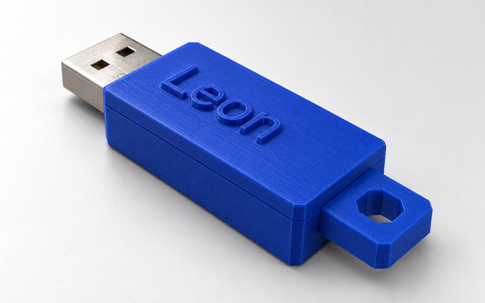

# RDW Workshop 3D Printen — USB-behuizing

Het ontwerpen van deze USB-behuizing was onderdeel van een RDW-workshop 3D printen.

Een blauwe, 3D-printbare behuizing voor de USB-stick uit [Dimensions.jpeg](references/Dimensions.jpeg). Het ontwerp bestaat uit een hoge onderbak met printverankering en sleutelhangoog, en een laag deksel met **Leon** en een instelbaar LED-venster. Op de onderkant staat het RDW-logo in reliëf.

Het [FreeCAD-model](USB-behuizing.FCStd) is via FreeCAD MCP opgebouwd met bewerkbare PartDesign-onderdelen. Alle maten hieronder zijn in millimeters.

## Bestanden

| Locatie | Inhoud |
| --- | --- |
| [USB-behuizing.FCStd](USB-behuizing.FCStd) | Bewerkbaar FreeCAD-model |
| [Codex-sessie.md](Codex-sessie.md) | Ontwerpgesprek: vragen van Leon en antwoorden van Codex |
| [LICENSE.md](LICENSE.md) | Licentieverdeling en uitzonderingen voor materiaal van derden |
| [LICENSES/](LICENSES/) | Volledige MIT- en CC BY 4.0-licentieteksten |
| [references/](references/) | Originele maatvoering en aangeleverd RDW-logo in SVG |
| [images/](images/) | Realistische voorbeeldrender en afbeeldingen uit FreeCAD |
| [exports/](exports/) | STEP-model en afzonderlijke STL-bestanden van onderbak en deksel |
| [scripts/build.py](scripts/build.py) | Python-script voor opbouwen, controleren en exporteren binnen FreeCAD |

De STL-bestanden zijn voor een slicer die printinstructies voor de Creality-printer maakt. Voor het bewerken van het ontwerp gebruik je het FCStd-bestand.

## Onderdelen en maatvoering

### Behuizing en connector

| Eigenschap | Maat |
| --- | --- |
| Rechthoekige behuizing, lengte × breedte × hoogte | 33,9 × 18,4 × 9,6 |
| Lengte inclusief sleutelhangoog | 42,9 |
| Totale hoogte inclusief tekst en logo | 11,2 |
| Wand, bodem en dak | 1,8 |
| Binnenruimte voor de print | 30,3 × 14,8 × 6,0 |
| Connectoropening | 12,7 × 5,2 |
| Vrij uitstekende connector | 13,0 |
| Speling naast en achter de print | 0,3 per zijde |
| Speling vóór de print | 0,2 |

De behuizingslengtes zijn exclusief de uitstekende USB-connector. De vier verticale buitenhoeken hebben vlakke facetten van 1 mm onder 45°. Bij die facetten blijft minimaal circa 1,84 mm materiaal over.

De connector blijft gecentreerd in de rechthoekige buitenvorm. De USB 2.0-specificatie noemt in figuur 6-9 minimaal 11,75 mm vrije stekkerlengte en in figuur 6-7 minimaal 2,67 mm afstand tussen poortvoorzijde en overmold bij gekoppelde toestand. De gekozen 13 mm is een nominale ontwerpmaat; passing op echte apparatuur is nog niet getest. Zie de [USB 2.0-specificatie](https://e2e.ti.com/cfs-file/__key/communityserver-discussions-components-files/138/usb_5F00_20.pdf).

### Onderbak en printverankering

De onderbak is 7,4 mm hoog. De deelnaad ligt 2,6 mm boven de hartlijn van de connector, zodat de print volledig onder de deelnaad ligt. Het deksel houdt de print tegen oplichten en kantelen.

| Verankering | Uitvoering | Nominale speling |
| --- | --- | --- |
| Twee voorste uitsparingen | Ronde nokken van Ø1,9 in uitsparingen van 2,5 breed en 2,0 diep | 0,3 |
| Achterste inkeping | Nok van 7,8 breed, met 2,7 insteek in de inkeping van 8,4 breed en 3,0 diep | 0,3 |

De nokken lopen vanaf de binnenbodem tot de deelnaad en vormen één geheel met de onderbak. Ze begrenzen beweging in beide lengterichtingen. De voorste printschouders blijven bovendien achter de voorwand haken: 0,75 mm overlap per zijde, of minimaal 0,45 mm bij zijwaartse verschuiving. Na 0,2 mm beweging richting connector raakt de print deze extra aanslag.

Bekijk de [binnenkant met print en LED](images/FreeCAD-binnenkant.png) of de [nokken zonder print](images/FreeCAD-verankering.png).

### Deksel, tekst en logo

Het deksel is 2,2 mm hoog, exclusief tekst. **Leon** staat 0,8 mm verhoogd op het dak, met een nominale letterhoogte van 6 mm in Helvetica Neue. De tekst is 2 mm richting connector verschoven om de LED-opening vrij te houden.

Het RDW-logo is proportioneel geschaald naar 28 mm breed en staat 0,8 mm verhoogd op de onderkant. De vier zichtbare SVG-elementen en hun uitsparingen zijn overgenomen. Het logo wordt in hetzelfde blauwe materiaal geprint. Tekst en logo zijn met hun behuizingsdeel verenigd tot één solid.

Afbeeldingen: [opgetild deksel](images/FreeCAD-exploded.png) en [onderkant met RDW-logo](images/FreeCAD-onderkant.png).

### Sleutelhangoog

Het oog zit achteraan de onderbak en is 10 mm breed, 4 mm dik en 9 mm uitstekend. De achthoekige ringopening heeft 4,5 mm vrije breedte. Buitenomtrek en opening hebben dezelfde 1 mm facetten als de behuizing.

Het oog loopt over de volledige 1,8 mm achterwanddikte in en vormt één solid met de onderbak. Voorbij het gat blijft 2,25 mm materiaal over. De sterkte van een fysieke print is nog niet getest.

### Referentieprint en LED

De groene print is een vereenvoudigde referentie van 29,8 × 14,2 mm met de drie bevestigingsuitsparingen. De printdikte van 1 mm is aangenomen; boorgaten en overige componenten zijn niet afzonderlijk gereconstrueerd.

De gele LED is een blokje van 1,6 × 0,8 × 0,6 mm bovenop de print, vóór de achterste inkeping. Het hart ligt op X=40 en Y=0. X wordt gemeten vanaf de connectortip; Y=0 is de middenlijn van de print. De LED blijft op zijn eigen positie wanneer je alleen het venster verschuift.

De print en LED zijn referentieonderdelen en zitten niet in de behuizingsexports. Hun zichtbaarheid blijft aan; het deksel kan ze aan het oog onttrekken. Verberg de **Bovenhelft** om het binnenwerk te bekijken.

## Instellingen in FreeCAD

### Maten aanpassen

Open het werkblad **Parameters** voor wanddikte, passingsruimte, nokken en het sleutelhangoog. Schetsen en features gebruiken deze waarden via expressies. De buitenhoogte volgt bijvoorbeeld uit 6 mm binnenruimte plus tweemaal de wanddikte.

De oogmaten heten **EyeExtension**, **EyeWidth**, **EyeThickness** en **EyeHole**. De LED is bewerkbaar via **LED - gele benadering** onder **Hardware referentie**. Overgenomen geometrie, zoals de vereenvoudigde print en het tekstprofiel, wordt niet bij elke parameterwijziging opnieuw uit de bron opgebouwd.

### LED-venster kiezen

1. Selecteer **LED-opening - kies Stand** in de modelboom.
2. Kies onder **Data → LED → Stand** een uitvoering:

| Stand | Resultaat |
| --- | --- |
| **Dun venster** — standaard | Blinde uitsparing vanaf de binnenkant; 0,4 mm gesloten dak blijft over |
| **Dicht** | Volledige wanddikte van 1,8 mm |
| **Open gat** | Doorgaande opening in het deksel |

In hetzelfde paneel kun je **Diameter**, **PositieX**, **PositieY**, **Restdikte** en **TekstVerschuiving** wijzigen. De voorlopige opening is Ø3 op X=40 en Y=0. Bij **Dun venster** moet de restdikte groter zijn dan nul en kleiner dan de wanddikte.

De keuzelijst stuurt een PartDesign Pocket, inclusief de ingebouwde eigenschap **Suppressed**. De keuze verandert dus de geometrie. Reken het model na een wijziging opnieuw door indien nodig en exporteer de **Bovenhelft** opnieuw: bestaande STL- en STEP-bestanden veranderen niet automatisch mee. De huidige exports en de standaard in het bouwscript gebruiken **Dun venster**.

Bekijk de [variant met open gat](images/FreeCAD-LED-open.png). Of de LED door 0,4 mm blauw filament voldoende zichtbaar is, moet nog worden getest.

## Printen en monteren

### Printoriëntatie

| Bestand | Oriëntatie | Ondersteuning |
| --- | --- | --- |
| [onderhelft.stl](exports/onderhelft.stl) | Deelnaad op het printbed, RDW-logo omhoog | Ondersteuning onder de naar beneden gerichte interne holte |
| [bovenhelft.stl](exports/bovenhelft.stl) | Deelnaad op het printbed, tekst omhoog | Controleer overbrugging of ondersteuning voor de ondiepe uitsparing van 0,4 mm |

Beide exports staan al op Z=0 in deze oriëntatie. Een laaghoogte van 0,2 mm is een startpunt; het dunne LED-venster bestaat dan uit twee lagen. Controleer de kleine logodetails en ondersteuning in de slicervoorvertoning. Gebruik blauw filament: STL bevat geen kleur.

Er is geen G-code gemaakt, omdat het specifieke Creality-model niet is opgegeven. Speling en krimp hangen ook af van materiaal en printerkalibratie.

### Montage

1. Proefpas de hardware vóór verlijmen.
2. Schuif de connector van binnenuit door de opening en laat de print over de drie nokken zakken.
3. Controleer dat de print vlak zit, de nokken in de inkepingen vallen en geen soldeerverbindingen of componenten worden geraakt. Controleer ook connectoruitsteek en LED-positie.
4. Lijm het deksel op de onderbak, zodat de print niet over de nokken kan kantelen. Het ontwerp heeft geen klikverbinding of schroeven.

## Werkwijze: van prompt tot model

### 1. Eisen en maatvoering vertalen

De oorspronkelijke prompt vroeg om een blauwe, rechthoekige behuizing die de print omsluit en de connector vrijlaat, geschikt voor een Creality-printer. De hardwarematen zijn uit de aangeleverde foto gelezen; ontbrekende maten zijn als aannames vastgelegd. De USB-specificatie is geraadpleegd voor de vrije connectorlengte en aansluitruimte.

Daaruit zijn een referentieprint, connectorvolume, binnenruimte en passingsspeling afgeleid. De hardwaregeometrie dient om plaatsing en botsingen te controleren. Ze is geen volledige elektronische reconstructie.

### 2. Eerst een visueel concept maken

Met de ingebouwde imagegen-tool is eerst een conceptbeeld gemaakt om de vorm te verkennen. Dat beeld was geen technische tekening en is niet als bron voor de CAD-geometrie gebruikt. De huidige [voorbeeldafbeelding](images/voorbeeld.png) is een realistische productvisualisatie, gemaakt met een afbeelding van het actuele CAD-model als referentie. De geometrische bron blijft het FreeCAD-model; de bestanden met **FreeCAD-** in hun naam zijn de directe CAD-afbeeldingen.

Het bouwscript vernieuwt alleen de directe CAD-afbeeldingen en overschrijft de realistische render niet. Bij ontwerpwijzigingen moet de render afzonderlijk worden bijgewerkt met de nieuwste CAD-referentie.

### 3. Geometrie opbouwen via FreeCAD MCP

Via FreeCAD MCP is Python uitgevoerd in FreeCAD 1.1.4. Het model is opgebouwd uit twee PartDesign Bodies met schetsen, Pads, Pockets en afschuiningen. Het werkblad **Parameters** koppelt de hoofdafmetingen aan de features. Het bouwproces is vastgelegd in [build.py](scripts/build.py).

Tekst is vanuit een lettercontour naar een schets omgezet en verhoogd geëxtrudeerd. Voor het RDW-logo zijn de zichtbare SVG-vormen geïmporteerd, geschaald en geëxtrudeerd. Illustrator-maskers en filters zijn voor die import verwijderd, zodat hun begrenzingsvlakken geen onderdeel van het reliëf worden. Deze bewerkingen voegen materiaal toe aan de bestaande solids.

### 4. Het ontwerp samen verfijnen

Op basis van de vervolginstructies is de wanddikte verlaagd naar 1,8 mm. De deelnaad is boven de print gelegd om uitglippen te voorkomen. Daarna zijn nokken in de printuitsparingen, facetten, tekst, het logo en het sleutelhangoog toegevoegd. De LED heeft een afzonderlijke referentie en een schakelbaar venster gekregen.

Elke aanpassing is in het bestaande model verwerkt. Het bouwscript is mee aangepast, zodat het de uiteindelijke vorm opnieuw kan opbouwen. Handmatige wijzigingen in een FCStd-bestand worden niet automatisch teruggeschreven naar het script; een volledige herbouw schrijft het model, de exports en afbeeldingen opnieuw vanuit de scriptinstellingen.

### 5. Controleren en exporteren

Na geometrische wijzigingen zijn solids, onderlinge overlap, passingsruimte en relevante bewegingsrichtingen gecontroleerd. De twee behuizingsdelen zijn naar STEP geëxporteerd. Voor STL is elke helft via **MeshPart.meshFromShape()** omgezet naar een gesloten mesh, met 0,05 mm lineaire afwijking en 15° hoekafwijking, en met **mesh.write()** opgeslagen. De exports zijn in hun printoriëntatie op Z=0 geplaatst.

## Controles en aannames

### Geometrisch gecontroleerd

- Beide behuizingsdelen zijn geldige, enkelvoudige solids; de elf schetsen zijn volledig bepaald en de delen overlappen niet in volume.
- De drie nokken hebben elk 0,3 mm afstand tot de nominale referentieprint. Bij 0,35 mm verplaatsing in beide lengterichtingen blokkeren ze de beweging. De voorwand vormt een aanvullende aanslag.
- De connector, LED en het vereenvoudigde componentenvolume passen zonder botsing met de behuizing.
- Alle drie LED-standen leveren geldige solids op. Het dunne venster laat 0,4 mm dak over en de opening raakt de tekst niet.
- Het oog is verbonden met de onderbak; een cilindrische doorgang van Ø4,5 past vrij door de ringopening.
- De STL-meshes zijn gesloten en staan op het printbed.

### Nog aan de echte hardware toetsen

De maat 28 is geïnterpreteerd als afstand van de achterrand tot het hart van de voorste uitsparingen. Hun harten liggen daarmee op X=16,8. Het U-profiel is benaderd met een halve cirkel van straal 1,25 en een rechte insteek van 0,75. De achterste afrondingen zijn niet bemaat. Controleer deze vormen vóór de definitieve print.

De opgegeven componenthoogte is 4, maar de verdeling boven en onder de print is onbekend. Daarom is 6 mm binnenhoogte aangehouden. Printdikte, LED-afmetingen en LED-positie zijn schattingen. Controleer ook de ruimte rond naastgelegen USB-poorten.

Fysieke passing, uittrekkracht, sterkte van het oog en lichtdoorlaatbaarheid van het filament zijn nog niet getest. De geometrische controles vervangen die proefpassing en printproef niet.

## Licenties

De Python-broncode valt onder de [MIT-licentie](LICENSES/MIT.txt). Het eigen CAD-ontwerp, de eigen inhoud van de exports, afbeeldingen en documentatie vallen onder [CC BY 4.0](LICENSES/CC-BY-4.0.txt), voor zover daarop rechten rusten die door de maker kunnen worden verleend. Bij hergebruik van die inhoud vermeld je **Leon Zandman — USB-behuizing**, de licentie en eventuele wijzigingen.

Het aangeleverde RDW-logo en de maatvoeringfoto zijn hiervan uitgezonderd. Dat geldt ook voor het logo waar het in modellen, exports of afbeeldingen is verwerkt. Helvetica Neue wordt niet als lettertypebestand meegeleverd. De projectlicenties regelen geen toestemming voor deze onderdelen van derden; hun rechten moeten afzonderlijk worden nagegaan.

Zie [LICENSE.md](LICENSE.md) voor de precieze verdeling en uitzonderingen.
